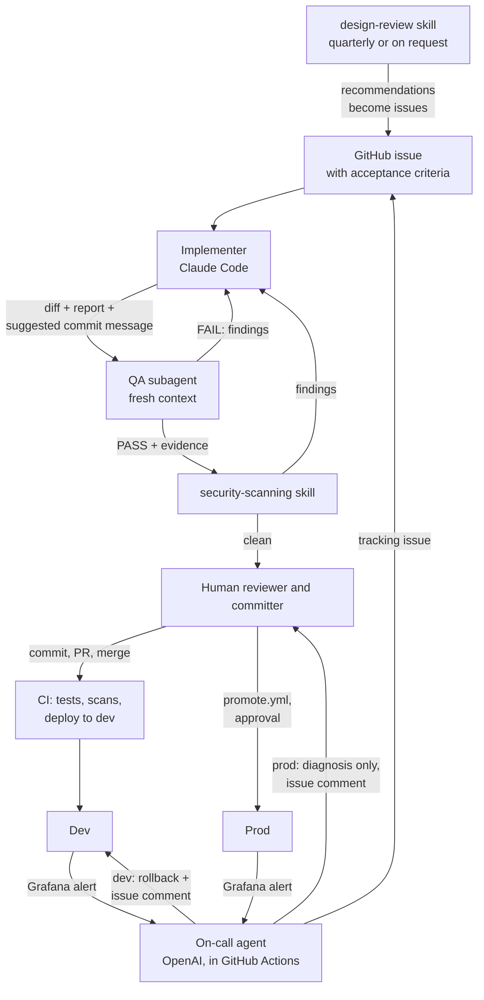

# Agent team

Who does what on Hub, and how work moves from one role to the next. Six
roles: four agents, one automated agent at run time, and the human who owns
every decision that leaves the working tree. The standing rules every agent
follows are in [AGENTS.md](AGENTS.md); the tracker is
[GitHub Issues](https://github.com/rdanielsstat/hub-platform/issues).

## Roles

### 1. Implementer: Claude Code

- **Owns:** turning an issue into a change in the working tree: code,
  tests, docs and the definition of done in `AGENTS.md` ("Testing"), with
  `make check` and `make test-all` clean and the counts reported.
- **Receives:** a GitHub issue with an "Acceptance criteria" checklist, or a
  prompt that names one. It comments its progress on the issue.
- **Hands off:** the diff, a summary of what changed, the test results and
  a suggested commit message, to the QA subagent and then the human.
- **Can't:** commit, push without asking, deploy, read secrets or delete
  data. The guard hook (`agent-hooks/guard.py`) enforces it.

### 2. QA subagent

- **Owns:** independent validation in a fresh context, so it doesn't share
  the implementer's assumptions. Definition: `.claude/agents/qa-engineer.md`.
- **Receives:** the issue's acceptance criteria and the change, from the
  implementer (or the human: "Launch QA subagent to review ...").
- **Hands off:** PASS or FAIL with evidence (test output, screenshots,
  steps to reproduce). FAIL goes back to the implementer; PASS goes on to
  the security scan.
- **Can't:** fix anything. It reports.

### 3. security-scanning skill

- **Owns:** the static checks CI doesn't run (bandit, trivy, the IaC scans)
  plus a review of the change against `security/SECURITY_CHECKLIST.md`.
  Definition: `.claude/skills/security-scanning/SKILL.md`.
- **Receives:** a change that passed QA, or a release candidate.
- **Hands off:** findings to the implementer, or a clean result to the
  human. Results are recorded in `security/`.

### 4. design-review skill

- **Owns:** the UI and UX audit: layout, components, data presentation,
  tools worth adopting. Definition: `.claude/skills/design-review/SKILL.md`.
- **Receives:** a request from the human, quarterly or before a UI change.
- **Hands off:** recommendations, which the human turns into GitHub issues
  with acceptance criteria for the implementer. It changes no code.

### 5. On-call agent: OpenAI, in GitHub Actions

- **Owns:** the first response to an alert on real user impact (the project
  creation 5xx rate, `infra/hub/grafana.tf`), with no human in the loop:
  triage, diagnosis, and on dev, the rollback.
- **Receives:** the Grafana alert, through the `repository_dispatch` event
  `grafana-alert` (`.github/workflows/observability-alert-handler.yml`).
- **Hands off:** a tracking issue with its diagnosis, the rollback outcome
  (dev) and the resolution. On prod it diagnoses and records only; the
  human decides the fix.
- **Can:** deploy, but only `rollback-dev.yml`, only to dev, only to the
  previous image, once per incident. That's the one exception to "agents
  never deploy" (README.md, "Alerting and the On-Call Agent").

### 6. Human reviewer and committer

- **Owns:** every decision that leaves the working tree: reviewing the diff,
  committing, opening and merging PRs, tagging releases, promoting to prod
  (`promote.yml` with a typed confirmation and a reviewer's approval),
  rotating secrets (`ops/DEPLOYMENT.md`, "Credential rotation"), applying
  `infra/bootstrap` by hand (the OIDC provider and the CI role, which
  trusts only the `dev` and `prod` environments), and closing on-call
  issues. OpenTofu for dev and prod runs in CI only; no role applies it
  from a laptop.
- **Receives:** the implementer's diff and report, QA's verdict, the
  security results and the on-call agent's issues.
- **Hands off:** a merged change, which CI tests and deploys to dev; a
  promotion to prod; new issues for the implementer.

## How a change moves

1. The human (or the design review, or the on-call agent) opens an issue
   with acceptance criteria.
2. The implementer builds it in the working tree, comments progress on the
   issue, and reports with a suggested commit message.
3. The QA subagent validates it against the criteria: FAIL loops back to 2.
4. For security-relevant changes and before a release, the security-scanning
   skill runs: findings loop back to 2.
5. The human reviews, commits, opens the PR with "Closes #N" and merges.
6. CI runs every test and scan and deploys to dev. The human checks dev and
   promotes to prod.
7. If users are hurt, Grafana alerts, and the on-call agent opens or updates
   the tracking issue, rolls dev back if the alert is on dev, and the human
   takes it from there.
