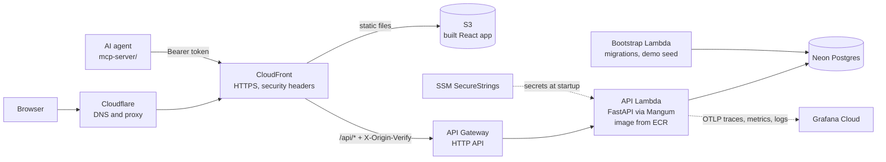
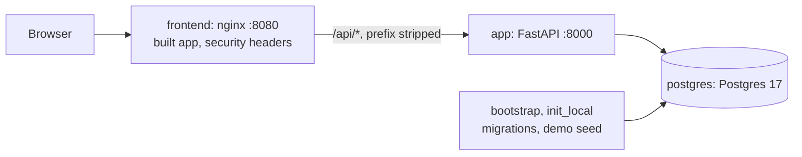
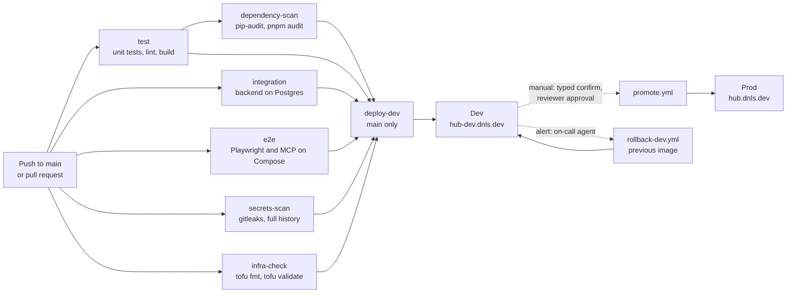
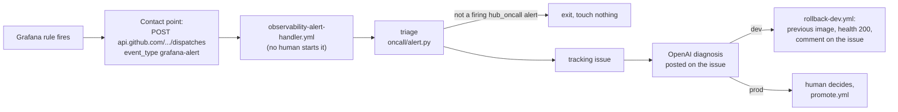

# Hub-Platform

A personal idea management system for capturing, triaging, and tracking ideas from spark to graduation. Built with AI assistance, containerized infrastructure, and production-grade observability.

[](https://www.python.org/downloads/)
[](https://fastapi.tiangolo.com/)
[](https://react.dev)
[](https://www.typescriptlang.org/)
[](https://www.postgresql.org/)
[](https://neon.tech/)
[](https://aws.amazon.com/lambda/)
[](https://grafana.com/)
[](https://www.docker.com/)

**Live environments:**
- Development: https://hub-dev.dnls.dev
- Production: https://hub.dnls.dev

**Documentation:**
- [product-spec.md](product-spec.md) - Product spec and data model (the source of truth)
- [Task tracker: GitHub Issues](https://github.com/rdanielsstat/hub-platform/issues) - Every feature as an issue with acceptance criteria, closed by its PR; the agents comment their progress there, and the on-call agent opens its incidents there
- [AGENTS.md](AGENTS.md) - Project instructions for AI agents and developers
- [AGENT_TEAM.md](AGENT_TEAM.md) - The agent team: each role, what it owns, and how work passes between them
- [openapi.yaml](openapi.yaml) - API contract (hand-written; a backend test checks the app matches it)
- [ops/](ops/) - Runbooks: [deployment](ops/DEPLOYMENT.md), [health checks](ops/HEALTH_CHECKS.md), [monitoring](ops/MONITORING.md), [troubleshooting](ops/TROUBLESHOOTING.md)
- [security/](security/) - [Security checklist](security/SECURITY_CHECKLIST.md), [rate limiting](security/RATE_LIMITING.md), [scan results](security/IAC_SCANS.md), [dependencies](security/DEPENDENCIES.md), [data policy](security/DATA_POLICY.md), [PR audit](security/PR_AUDIT.md), and more
- [docs/agent-extension-pack.md](docs/agent-extension-pack.md) - The agent extension pack: skills, subagent, MCP server, guard hook ([agent-capabilities/](agent-capabilities/README.md) lists them all)
- [docs/permissions.md](docs/permissions.md) - Agent security boundaries and permissions
- [docs/tech-debt.md](docs/tech-debt.md) - What's done, what's left

## Demo Account

Reviewers can explore the live app without signing up:

1. Open https://hub.dnls.dev
2. Log in with:
   - Email: `demo@hub.dev`
   - Password: `demo-hub-2026`

The account comes with seeded sample ideas and notes to explore. It is read/write and shared by all reviewers, so its data may change during the review. It is temporary and valid through the end of the review period. Login is limited to 5 attempts per minute per IP; if you see "Too many login attempts", wait a minute and try again. To keep your own data private, sign up with any email instead.

---

## What is Hub-Platform?

Hub-Platform is a personal hub for capturing ideas, scoring them, and tracking them through a lifecycle. Sign up, quickly capture an idea with a one-line pitch, brain-dump description, and scoring (excitement, potential, effort). Track ideas through statuses (inbox, exploring, active, parked, graduated, killed), add notes, set target dates, and filter your dashboard by status, tag, or search text, sorted by score, date, or name.

### Key features

- **Quick capture**: One-screen form to capture an idea with minimal friction
- **Lifecycle tracking**: Move ideas from inbox through exploring, active, parked, graduated, or killed
- **Scoring system**: Rate excitement, potential, and effort; opportunity score calculated automatically
- **Dashboard filtering**: Filter by status or tag, search by text, and sort by recently updated, scores, target date, or name
- **Notes and links**: Add notes to ideas and link to external resources
- **Personal workspace**: Individual signup and login; your ideas, your rules
- **Deployed**: Runs on AWS, with separate dev and prod environments, both live, and OpenTelemetry traces, metrics and logs in Grafana Cloud for dev and prod
- **Self-healing dev**: an alert on real user impact (project creation failing) wakes an on-call agent that diagnoses it and rolls dev back to the previous image, with no human in the loop
- **Hardened**: Security headers (strict CSP, HSTS), per-IP rate limits, usage caps and length limits, origin verification, scanned images and dependencies (see [security/SECURITY_CHECKLIST.md](security/SECURITY_CHECKLIST.md))
- **Resilient sign-in**: A slow or unreachable backend shows a retry screen instead of signing you out
- **Frontend error reporting**: Browser errors and failed API calls are reported to the backend and land in Grafana Cloud
- **AI-native development**: Built with Claude Code using spec-driven development, AI skills, and specialized subagents

### Typical workflow

1. Sign up with email and password
2. Land on dashboard showing all your ideas with tiles displaying name, pitch, scores, and status
3. Click "quick capture" to add a new idea
4. Enter project name, one-line pitch, brain-dump description, status, and scores (excitement, potential, effort)
5. See the new idea tile on your dashboard immediately
6. Click a tile to open the full project page
7. Add notes, links, update target date, refine scores
8. Filter the dashboard by status or tag, search it, or sort by recently updated, scores, target date, or name

---

## Quick Start

### Prerequisites

- [uv](https://docs.astral.sh/uv/) (installs and manages Python 3.12 for the backend)
- Node.js 22 (install with a version manager such as nvm or fnm)
- pnpm 12.3 (the version is pinned in `frontend/package.json`)
- Git
- Docker, only for the optional Compose stack (the whole system on Postgres; Docker alone is enough to run it) and the observability stack

### Run locally

Locally the backend uses a SQLite file (`backend/hub.db`), so no database server is needed.

**Terminal 1: backend**

```bash
git clone https://github.com/rdanielsstat/hub-platform.git
cd hub-platform/backend

# Install dependencies
uv sync

# Apply the database migrations and create the demo account
# (again after pulling a change that adds a migration)
SEED_DEMO_DATA=true uv run python -m app.db.init_local

# Start the API on http://localhost:8000
uv run uvicorn app.main:app --reload
```

**Terminal 2: frontend** (from the `hub-platform` folder)

```bash
cd frontend

# Point the frontend at the local backend (once)
cp .env.example .env

pnpm install
pnpm dev
```

Visit `http://localhost:5173` and log in as `demo@hub.dev` / `demo1234`, or sign up. Interactive API docs are at `http://localhost:8000/docs`.

### Run with Docker Compose (the whole system)

To run everything in containers, with the backend on Postgres 17 instead of SQLite, from the repo root (only Docker needed):

```bash
docker compose up --build
```

Then open `http://localhost:8080` and log in as `demo@hub.dev` / `demo1234`, or sign up. This starts:
- Postgres 17
- `bootstrap`: creates the database and a least-privilege login role, then applies the Alembic migrations as that role
- `init_local`: checks the schema is at the latest migration and seeds the demo account
- `app`: the FastAPI backend, also published on `http://localhost:8000` (API docs at `/docs`)
- `frontend`: nginx serving the production build of the web app on `http://localhost:8080`, forwarding `/api/*` to `app` the way CloudFront does when deployed, with the same security headers (`frontend/Dockerfile`, `frontend/nginx.conf`)

`make docker-up` does the same in the background and waits until both answer; `make docker-down` stops it (the database volume is kept). The observability stack is a separate compose file (see [Observability](#observability)).

---

## Architecture

### System design



A user opens Hub-Platform in a web browser. Requests go through Cloudflare (DNS and proxy) to CloudFront (HTTPS), which adds security headers (CSP, HSTS and related) to every response. CloudFront serves the built React app from a private S3 bucket and forwards `/api/*` requests to an API Gateway HTTP API, adding a secret origin-verification header, so the frontend and API share one origin. API Gateway invokes the backend Lambda, a container image from ECR running FastAPI through Mangum, which strips the `/api` prefix. The Lambda stores data in Neon Postgres. A separate bootstrap Lambda applies the Alembic migrations (and seeds the demo account) on every deploy, before the API Lambda switches to new code. In both dev and prod, OpenTelemetry sends traces, metrics and selected logs (including frontend error reports) from the backend to Grafana Cloud.

An AI agent can use the same API through the MCP server in `mcp-server/`, signed in as one user with a Bearer token (see [AI-Native Development Workflow](#ai-native-development-workflow)).

Locally, the frontend runs on the Vite dev server (`http://localhost:5173`) and calls the backend directly on `http://localhost:8000`, which uses SQLite. Docker Compose runs the whole system instead: nginx on `http://localhost:8080` serves the production build and forwards `/api/*` to the backend, which uses Postgres 17, mirroring CloudFront and Neon:



### Component overview

**Frontend (React 19)**
- TypeScript 5.7 with strict mode
- Vite 6.4 for bundling
- Tailwind CSS 4.3 + shadcn/ui (base-nova neutral)
- Component library: @base-ui/react 1.5 (headless), lucide-react for icons
- State management: React Context (no external library)
- Testing: Vitest 5.0 + React Testing Library 16
- Dashboard with filtering and sorting
- Quick capture form and detailed project view

**Backend (FastAPI)**
- Python 3.12 with Pydantic 2.13 for validation
- SQLAlchemy 2.0 ORM (database-agnostic)
- OpenTelemetry instrumentation
- Authentication: JWT + argon2 password hashing; the web app's session is an httpOnly, SameSite=Strict cookie, and the API also accepts bearer tokens
- Testing: pytest 9.1
- RESTful API for CRUD operations on ideas and notes

**Database**
- SQLite for local development and testing
- Postgres 17 for production (via Neon)
- SQLAlchemy 2.0 with Alembic migrations (`backend/alembic/versions/`): applied by `init_local` locally and by the bootstrap Lambda on each deploy, before the new API code goes live. The app itself does no database work at startup.
- Schema: users, auth_identities (auth), projects (ideas), notes; length and count limits enforced by CHECK constraints as well as the API
- Backups: Neon point-in-time restore (6-hour window on the current plan), tested 2026-10-04 (`ops/DEPLOYMENT.md`, "Backup Testing")

**Infrastructure**
- AWS Lambda (compute)
- API Gateway HTTP API (routes `/api/*` to Lambda)
- AWS ECR (container registry; immutable tags, scan on push)
- Neon Postgres (managed database)
- CloudFront (CDN + HTTPS, security headers)
- Cloudflare (DNS, and proxy in front of CloudFront)
- S3 (frontend static assets)
- OpenTofu 1.12.6 (IaC)
- GitHub Actions (CI/CD; actions pinned to commit SHAs)

**Security controls (deployed)**
- Session cookie `hub_token`: HttpOnly, SameSite=Strict, Secure
- Login CSRF: sign-in and sign-up refuse a request from another site's `Origin` (403), so a page elsewhere can't log your browser into its account
- Security headers on every response (CloudFront): a strict Content-Security-Policy (no inline scripts), HSTS (one year, includeSubDomains, preload), `X-Frame-Options: DENY`, nosniff, Referrer-Policy
- Rate limits per client IP: login 5 attempts per minute, sign-up 3, frontend error reports 30 (429 over any); API Gateway throttles at 50 rps, burst 100
- The real client IP behind Cloudflare and CloudFront: `CloudFront-Viewer-Address`, then `X-Forwarded-For` when that hop is one of Cloudflare's ranges (`TRUSTED_PROXY_IPS`), so the limits are per user; verified from two networks
- Usage caps (1000 accounts, 500 projects per user, 500 notes per project) and length limits on every text field and list (422 over them, backed by CHECK constraints)
- Login passwords capped at 256 characters before argon2 hashing
- Origin verification: CloudFront adds a per-environment secret `X-Origin-Verify` header; the API answers 403 without it, so the public `execute-api` URL can't bypass CloudFront
- Dev and prod both count as deployed (`USE_SSM` on), so both get these controls and hide the API docs
- Supply chain: gitleaks (pre-commit and full history in CI), pip-audit and pnpm audit in CI (HIGH and above block the deploy), trivy image scans, GitHub Actions pinned to commit SHAs, `main` protected against force-push and deletion
- Details: [security/SECURITY_CHECKLIST.md](security/SECURITY_CHECKLIST.md), `backend/README.md` ("Auth", "Rate limits", "Usage caps", "Origin verification")

**Observability**
- OpenTelemetry SDK (Python): traces and metrics, with FastAPI and SQLAlchemy instrumentation, plus selected logs (frontend error reports, database outages, rejected direct API calls)
- Grafana Cloud (dev and prod): Tempo for traces, Prometheus for metrics, Loki for logs
- Optional local stack: OTel Collector, Prometheus, Tempo, Loki, Grafana

---

## Technology Stack

### Frontend Stack

```
React 19.2                      Component framework
TypeScript 5.7                  Type safety
Vite 6.4                        Bundler and dev server
Tailwind CSS 4.3                Utility-first styling
shadcn/ui (base-nova)           Component library
@base-ui/react 1.5              Headless components
lucide-react                    Icon library
react-router-dom 7.18           Client-side routing
pnpm 12.3                       Package manager
Vitest 5.0                      Unit test runner
@testing-library/react 16       Component testing
Playwright 1.63                 End-to-end tests
Prettier 3                      Code formatter
ESLint 10                       Linter
```

### Backend Stack

```
FastAPI 0.141                   Web framework (Starlette 1.7)
Uvicorn 0.53                    ASGI server
Pydantic 2.13                   Data validation
SQLAlchemy 2.0                  ORM
Alembic 1.20                    Schema migrations
psycopg 3.3.6                   Postgres driver
argon2-cffi 25.1                Password hashing
PyJWT 2.15                      JWT tokens
python-multipart                Form parsing
Mangum 0.22                     ASGI to Lambda adapter
boto3                           AWS SDK
OTel Python SDK 1.45            Traces, metrics and logs
pytest 9.1 + httpx2             Testing
Ruff 0.16                       Linter and formatter
```

### Infrastructure Stack

```
AWS Lambda                      Compute
AWS API Gateway (HTTP API)      Routes /api/* to Lambda
AWS ECR                         Container registry
AWS CloudFront                  CDN / HTTPS / security headers
AWS S3                          Static asset storage
AWS SSM Parameter Store         Secrets (SecureString)
Cloudflare                      DNS and proxy
Neon Postgres                   Managed database
Grafana Cloud                   Traces, metrics, logs, alerting
OpenTofu 1.12.6                 Infrastructure as code
GitHub Actions                  CI/CD
Docker                          Containerization
nginx 1.30 (unprivileged)       Serves the web app in local Docker Compose
```

### Agent Extension Stack

```
MCP Python SDK (mcp) 2.2        MCP server (mcp-server/)
httpx2 2.13                     Its HTTP client for the Hub API
Claude Code hooks               PreToolUse guard (agent-hooks/, standard library Python 3.9+)
Claude Code skills, subagents   .claude/skills/, .claude/agents/
gitleaks 8.30 (pre-commit)      Secret scan before each commit
```

---

## Local Development

### Installation

**Using `uv` for Python** (from `backend/`):

```bash
cd backend

# Install dependencies (creates virtual environment)
uv sync

# Add a package
uv add package-name

# Run a Python file
uv run python script.py

# Run pytest
uv run pytest
```

**Using `pnpm` for Node** (from the repo root):

```bash
cd frontend

# Install dependencies
pnpm install

# Add a package
pnpm add package-name

# Run dev server
pnpm dev

# Run tests
pnpm test

# Build for production
pnpm build
```

### Development Server

**Backend** (from `backend/`):

```bash
uv run uvicorn app.main:app --reload
```

Visit `http://localhost:8000/docs` (Swagger UI) or `http://localhost:8000/redoc` for interactive API documentation.

**Frontend** (from `frontend/`, with `.env` copied from `.env.example`):

```bash
pnpm dev
```

Visit `http://localhost:5173`.

### Make Targets

The `Makefile` at the repo root wraps the common commands; `make help` lists every target. Setup, linting and Docker (the test targets are in the next section):

```bash
make install           # uv sync (backend, mcp-server) and pnpm install (frontend)
make check             # fast gate: lint, format check, unit tests and frontend build (no services)
make lint              # lint-backend + lint-frontend + lint-mcp + lint-hooks
make lint-backend      # Ruff lint and format check
make lint-frontend     # ESLint (fails on any warning) and Prettier check
make lint-mcp          # Ruff lint and format check of mcp-server/
make lint-hooks        # Ruff lint and format check of agent-hooks/ (Python 3.9 target)
make fmt               # auto-fix: Ruff (backend, mcp-server, agent-hooks), Prettier (frontend)
make docker-up         # build and start the Compose stack; waits until the API and the web app answer
make docker-db-up      # start only the Compose Postgres; waits until it's healthy
make docker-down       # stop the Compose stack (keeps the database volume)
make docker-logs       # follow the Compose logs
```

### Running Tests Locally

From the repo root. **The single test command is `make test-all`**: it runs the unit tests, starts the Docker Compose stack, runs the integration tests, the MCP server's live test and both Playwright projects against it, then stops the stack, and exits non-zero if any layer failed. Only Docker, uv, Node 22 and pnpm are needed.

```bash
make test-all          # everything below, on a Compose stack it starts and stops itself
```

The layers on their own:

```bash
make test-unit         # backend, frontend, MCP server and agent hook unit tests; no services
make test-backend      # just the backend unit tests (`make test` is an alias for test-unit)
make test-frontend     # just the frontend Vitest tests
make test-mcp          # just the MCP server's tests (a fake Hub API)
make test-hooks        # just the agent hook's tests (standard library unittest)
make test-integration  # backend tests against the Docker Compose Postgres (starts it)
make test-mcp-live     # the MCP server's tools against a real backend on :8000
make test-e2e          # Playwright browser + API tests; needs a backend on :8000
make test-e2e-docker   # Playwright against the full Compose stack, incl. the nginx frontend and Postgres outages
make check             # lint, format, unit tests and build: the fast gate, not the full suite (see test-all)
```

Or by hand:

```bash
# Backend (from backend/)
uv run pytest                  # unit tests only
uv run pytest -m integration   # integration tests; needs `docker compose up -d --wait postgres`

# Frontend (from frontend/)
pnpm test
pnpm lint
pnpm build
pnpm format:check
pnpm exec playwright test --project=chromium   # E2E; needs a backend on :8000

# MCP server (from mcp-server/)
uv run pytest                  # unit tests (fake API)
uv run pytest -m integration   # live test; needs a backend on HUB_API_URL (default :8000)

# Agent hook (from the repo root)
python3 -m unittest discover -s agent-hooks/tests -t agent-hooks
```

Details: `backend/README.md` ("Run the tests"), `frontend/README.md`, `mcp-server/README.md` and `agent-hooks/README.md`.

### Database Management

**Apply migrations and seed demo data** (from `backend/`):

```bash
SEED_DEMO_DATA=true uv run python -m app.db.init_local
```

This brings the local SQLite file `backend/hub.db` up to the latest Alembic migration, and, if the database has no users yet, creates one demo account (`demo@hub.dev` / `demo1234`) with ten sample projects and their notes. It's safe to run again: it only applies pending migrations, and an existing database is never re-seeded. Schema changes and the `uv run alembic ...` commands are in `backend/README.md` ("Migrations").

A migration that adds a limit refuses to run over existing data that already breaks it, rather than truncating it; old local test data can trigger that. See `ops/TROUBLESHOOTING.md`.

**Reset the database:**

```bash
# SQLite (from backend/), then run init_local again
rm hub.db

# Docker Compose Postgres (from the repo root): deletes the data volume
docker compose down -v
```

### Local Docker Compose (Production Parity)

To run the whole system as it runs when deployed, with Postgres and the production frontend build (from the repo root):

```bash
docker compose up --build
```

This starts Postgres 17 (with a persistent volume), creates the database and role, applies the migrations, seeds the demo account, serves the API on `http://localhost:8000`, and serves the web app on `http://localhost:8080` (nginx, forwarding `/api/*` to the API). `make docker-up` does the same in the background and waits until both answer; `make docker-logs` follows its logs and `make docker-down` stops it, keeping the database volume. Stop the API from Terminal 1 first if it's running, since both use port 8000.

The nginx container stands in for CloudFront: the same security headers (minus HSTS and `upgrade-insecure-requests`, which need HTTPS), the same SPA routing (extensionless paths get `index.html`, missing files a 404), and `/api/*` forwarded with the prefix stripped, as Mangum does. To work on the frontend with hot reload instead, run `pnpm dev` from `frontend/` against the Compose API and open `http://localhost:5173`.

**Test the workflow:**
1. Sign up with an email and password
2. Create a new project using quick capture
3. Fill in name, pitch, description, and scores
4. View the dashboard with your new project tile
5. Click the tile to open the project page
6. Add notes and links
7. Update scores or change status
8. Return to dashboard and filter by status or tag

---

## Deployment Architecture

### CI/CD Pipeline



A developer pushes code to main. GitHub Actions runs six checks: the OpenTofu checks (`tofu fmt` and `tofu validate` of `infra/`, which also run on every pull request), plus unit tests (backend, frontend, MCP server and agent hook) with the backend, frontend and MCP lint, format and build checks, a dependency scan (pip-audit and pnpm audit over the backend, MCP server and frontend locks; HIGH and CRITICAL fail it) after the unit tests, a gitleaks history scan, backend integration tests against Postgres, and the Playwright E2E tests and the MCP server's live test against the Docker Compose stack (pull requests run only these checks). All six gate the deploy. If they pass, CI builds a Docker image, tags it with a timestamp and short SHA (e.g., 20261001-163457-83242da), and pushes it to the dev ECR repository (tags are immutable). It then points the bootstrap Lambda at the new image and runs it, which applies any database migrations; only then does it apply the rest of the dev infrastructure with OpenTofu, which switches the API Lambda to the new code. Finally it builds the frontend, uploads it to S3, and smoke-tests `/api/health`. After testing in dev, a release owner manually runs the promote workflow (typed confirmation plus a reviewer's approval), which copies the same image from dev ECR to prod ECR (no rebuild), runs the prod migrations the same way, deploys the image to the production Lambda, and builds and uploads the frontend. Every action is pinned to a commit SHA. Details: `ops/DEPLOYMENT.md`.

### Environments

**Development**
- Automatic deployment on every push to main
- Latest code always running
- Internal testing and validation
- Automatic rollback to the previous image when its project creation alert fires (`rollback-dev.yml`, run by the on-call agent; `ops/DEPLOYMENT.md`, "Rolling back")

**Rollback path:** dev rolls back on its own, or by hand from Actions > "Roll back dev"; prod rolls back by rolling dev back and promoting again (same confirmation and approval). OpenTofu runs only in these workflows, never from a laptop (`infra/BOOTSTRAP.md`).

**Production**
- Manual promotion from development
- Tested release selected by release owner
- Live at https://hub.dnls.dev

### Release Process

**Creating a release:**

```bash
# On main branch, verify clean state
git status

# Determine next version (using git describe)
git describe --tags --long --match 'v[0-9]*.[0-9]*.[0-9]*'

# Tag the release
git tag -a v0.2.0 -m "Release v0.2.0"

# Push tag and code to main
git push origin v0.2.0
git push origin main
```

After pushing:
1. CI builds and deploys to dev (tag doesn't trigger CI; next push to main does)
2. SERVICE_VERSION updates to the semantic version on dev Lambda
3. Verify the release at https://hub-dev.dnls.dev
4. Manually promote to production via GitHub Actions workflow

For detailed release workflow, see `.claude/skills/release/SKILL.md`.

### Scaling and Infrastructure

The current setup deploys to a single Lambda with Neon Postgres:
- Lambda scales concurrency automatically
- Neon scales compute automatically, but suspends after 5 minutes idle, so the first request after an idle period is slow
- CloudFront caches static assets

---

## Observability

### What we monitor

The backend is instrumented with OpenTelemetry (`backend/observability/`):

- **Traces** for every API request (FastAPI) and database query (SQLAlchemy)
- **Per-endpoint metrics**: request count, error count, and latency for each API route (for example `projects_create_total`, `projects_create_errors_total`, `projects_create_latency_ms`)
- **Account and activity counters**: logins and signups (with their errors), accounts created, projects created, notes created
- **Logs**: one structured line per project creation (the key journey: outcome, status, duration and `trace_id`, nothing from the request), frontend error reports (`POST /client-errors`: uncaught browser errors, render crashes, failed API calls), database outages, and rejected direct API calls, each linked to its trace

**The key journey, project creation, end to end:** a `POST /projects` request has one trace in Tempo, counts in `projects_create_total`, `projects_create_errors_total` and `projects_create_latency_ms` (whose exemplar carries the request's `trace_id`), and logs one `project_create` JSON line in Loki with the same `trace_id`. `backend/tests/test_journey_log.py` checks the three ids match and that the line holds no email, credentials or request body. No customer data or credentials go to telemetry (`security/DATA_POLICY.md`).

Every metric, trace and log is tagged with the deployed version (`SERVICE_VERSION`, from git tags), and every endpoint metric with its environment (`hub_environment`). Queries and alerts: `ops/MONITORING.md`.

### Where telemetry goes

- **Dev** (`hub-dev.dnls.dev`): the dev Lambda exports traces, metrics and logs to Grafana Cloud over OTLP/HTTP.
- **Production** (`hub.dnls.dev`): the prod Lambda exports traces, metrics and logs to Grafana Cloud over OTLP/HTTP.
- **CloudWatch Logs** also keeps every Lambda's output for 14 days.
- **Local**: off by default. Turn it on to send to the optional local stack below.

### Local Observability (optional)

A separate stack, `backend/observability/docker-compose.yml`, runs an OpenTelemetry Collector, Prometheus, Tempo, Loki, and Grafana for checking instrumentation changes. From `backend/`:

```bash
# Start the stack
docker compose -f observability/docker-compose.yml up -d

# Start the backend with telemetry on (sends to the local collector)
OTEL_ENABLED=true uv run uvicorn app.main:app --reload
```

| Service        | URL                     |
| -------------- | ----------------------- |
| Grafana        | http://localhost:3000 (login `admin` / `admin`) |
| OTel Collector | http://localhost:4318 (OTLP/HTTP in) |
| Prometheus     | http://localhost:9090   |
| Tempo          | http://localhost:3200   |
| Loki           | http://localhost:3100   |

There are no prebuilt dashboards: use Grafana's **Explore** view to query metrics (Prometheus), traces (Tempo) and logs (Loki), all under service name `hub-platform`. See `backend/observability/README.md` for details.

---

## Alerting and the On-Call Agent

### The alert: real user impact on the key journey

"Project creation 5xx rate above 2%", one rule for dev and one for prod, fires when more than 2% of `POST /projects` requests answer 5xx over a 5 minute window, once there were at least 10 requests in it. It measures users failing to save their ideas, not CPU or memory, and a 409 or 422 (the user's input) doesn't count. It's code, in `infra/hub/grafana.tf` (the rule group, the webhook contact point and the notification policy), applied by CI.

### The agent: wakes on the alert, fixes dev



1. The alert fires and Grafana's contact point calls GitHub's `repository_dispatch` API (`event_type: "grafana-alert"`, token `GH_DISPATCH_TOKEN`), which starts `.github/workflows/observability-alert-handler.yml`. No one starts or approves it.
2. `backend/oncall/alert.py` triages the payload. Anything but a firing (or resolved) alert from a rule labeled `hub_oncall="true"` ends the run without touching anything.
3. It opens (or reuses) a GitHub issue for the incident and posts an OpenAI diagnosis (`backend/oncall/diagnose.py`, the `OPENAI_API_KEY` secret, a $5/month spend guard).
4. **On dev** it runs `.github/workflows/rollback-dev.yml`: the previous dev image from ECR, a targeted apply of the two dev Lambdas, GET `/api/health` must return 200, and the outcome goes on the issue. Once per incident, never across a migration.
5. **On prod** it stops after the diagnosis: a human decides and promotes the fix.
6. When the alert resolves, the resolution goes on the issue.

Details: [custom-agent/on-call-diagnostic/README.md](custom-agent/on-call-diagnostic/README.md). The manual diagnosis path (`workflow_dispatch`, with reviewer approval) is still there.

### The one exception to "agents never deploy"

Interactive agents (Claude Code) never deploy: `AGENTS.md` says so and the guard hook (`agent-hooks/guard.py`) blocks every deploy command, workflow start and `tofu apply`. That's unchanged. The on-call agent is a GitHub Actions workflow, not Claude Code, and its only deploy path is `rollback-dev.yml`: dev only, the previous image only, two Lambdas only, once per incident. `backend/tests/test_workflow_permissions.py` checks that scope. Prod still needs a human, a typed confirmation and a reviewer's approval.

### Drill

The runbook (turn on `FAULT_INJECT_5XX` on dev, send project creations until the alert fires, watch the agent roll back, confirm health and resolution, turn it off) and the record of each drill, with run URLs and timestamps, are in [security/OPERATIONAL_DIAGNOSIS.md](security/OPERATIONAL_DIAGNOSIS.md). `FAULT_INJECT_5XX` is off by default, set only through the dev GitHub environment, ignored by the app in prod and refused by OpenTofu outside dev.

Latest drill: *not yet run with the automatic path; record it here (run URLs, timestamps) when it is.*

---

## API

The backend exposes a REST API. Locally it's at `http://localhost:8000` with no prefix. When deployed, the same routes are under `/api` on the site (for example `https://hub-dev.dnls.dev/api/projects`), because CloudFront forwards `/api/*` to the backend.

### Interactive documentation

Locally only: `http://localhost:8000/docs` (Swagger UI) or `http://localhost:8000/redoc` (ReDoc). The deployed API doesn't serve them.

### Main endpoints

**Health:**
```
GET    /health                    Liveness check (no login needed)
```

**Authentication:**
```
POST   /auth/register             Create an account; returns a token and sets the session cookie
POST   /auth/login                Log in (form fields); returns a token and sets the session cookie
POST   /auth/logout               Clear the session cookie (no login needed)
GET    /auth/me                   The logged-in user
```

Logging out clears the browser's `hub_token` cookie. Tokens are stateless JWTs, so a token kept elsewhere stays valid until it expires (60 minutes by default).

**Projects (ideas):**
```
GET    /projects                  List your projects
POST   /projects                  Create a project
GET    /projects/{id}             Get one project
PATCH  /projects/{id}             Update some fields (name, pitch, status, scores, etc.)
DELETE /projects/{id}             Delete a project and its notes
```

**Notes:**
```
GET    /projects/{id}/notes       List a project's notes
POST   /projects/{id}/notes       Add a note
DELETE /notes/{id}                Delete a note
```

Notes can be added and deleted, not edited.

**Frontend error reports:**
```
POST   /client-errors             Report a browser error (no login needed; rate limited)
```

### Authentication

Every endpoint except `/health`, `/auth/register`, `/auth/login`, `/auth/logout` and `/client-errors` needs a JWT. The web app sends it as the httpOnly `hub_token` cookie that register and login set (`HttpOnly`, `SameSite=Strict`, and `Secure` when deployed); API clients send it as an `Authorization: Bearer` header. If both are present, the header wins.

```bash
# Sign up (JSON)
curl -X POST http://localhost:8000/auth/register \
  -H "Content-Type: application/json" \
  -d '{
    "email": "user@example.com",
    "password": "secure-password",
    "displayName": "Your Name"
  }'

# Log in (form fields named username and password, not JSON)
curl -X POST http://localhost:8000/auth/login \
  -d "username=user@example.com" \
  -d "password=secure-password"

# Use the access_token from either response
TOKEN='<access_token from the response>'
curl http://localhost:8000/projects \
  -H "Authorization: Bearer $TOKEN"
```

### Field limits

- **Password:** 8 to 256 characters, at sign-up and at login.
- **Email:** must be a valid address.
- **Display name:** up to 100 characters.
- **Project text fields:** name up to 256 characters, pitch 2000, description 5000, next action 1000. Lengths count characters, not bytes.
- **Notes:** up to 10000 characters each.
- **Tags:** up to 50 per project, each up to 64 characters.
- **Links:** up to 50 per project; URLs must start with `http://` or `https://` and be at most 2048 characters; labels up to 200.
- Over any limit: `422`. The database enforces the same limits (CHECK constraints), except per-tag and per-link lengths, which only the API checks. An empty or whitespace-only project name or note body is a `422` too (issue #12); text that isn't blank is stored exactly as sent.
- **Scores** (`excitement`, `effort`, `potential`): whole numbers from 1 to 5.
- **Usage caps:** 500 projects per user, 500 notes per project, and (deployed) 1000 accounts in total; over a cap, `403`.
- **Rate limiting (deployed only):** per client IP, 5 login attempts, 3 sign-ups and 30 error reports per minute; over that, `429` with a `Retry-After` header. API Gateway also caps the whole API at 50 requests/second (bursts to 100). Off for local runs.

### Error responses

Most errors return a single message in `detail`:

```json
{"detail": "Incorrect email or password"}
```

Validation errors (`422`) return `detail` as a list, one entry per invalid field, with its location and a message:

```json
{
  "detail": [
    {
      "type": "string_too_short",
      "loc": ["body", "password"],
      "msg": "String should have at least 8 characters",
      "input": "short",
      "ctx": {"min_length": 8}
    }
  ]
}
```

Status codes: `401` for a missing, invalid, or expired token (or a wrong login), `403` for a usage cap (with a message saying which), `404` for a project or note that doesn't exist or belongs to another user (the two look the same on purpose), `409` for an email that's already registered, `422` for invalid input, `429` when a rate limit is hit, and `503` with `Retry-After` when the database can't be reached (for example while Neon resumes; retry, it never means you're signed out). Deployed, a request sent straight to the API Gateway URL instead of through the site gets `403 {"detail": "Forbidden"}` (origin verification; see `backend/README.md`).

For the full API contract, see `openapi.yaml`. It's written by hand, and `backend/tests/test_openapi_contract.py` fails if its endpoints and the app's drift apart.

---

## Testing

### Test structure

```
backend/
  tests/
    test_auth.py              Signup, login, tokens
    test_projects.py          Project CRUD, validation, per-user isolation
    test_notes.py             Notes
    test_text_limits.py       Length limits (API and database)
    test_migrations.py        Alembic migrations, including a drift check
    test_openapi_contract.py  App and openapi.yaml declare the same endpoints
    test_*.py                 Config, startup, rate limits, caps, error reports,
                              observability, on-call agent, and more
    integration/              Same app against real Postgres (Docker Compose)

frontend/
  src/
    **/*.test.ts(x)           Unit and component tests, next to the code
                              they cover (pages, components, store, API client)
  tests/
    app.spec.ts               Playwright: browser flows
    api.spec.ts               Playwright: live API tests
    integration.spec.ts       Playwright: the Compose stack (incl. the nginx
                              frontend), error reporting, outages
    helpers.ts                Shared setup

mcp-server/
  tests/
    test_client.py            Login, token refresh, error reporting
    test_server.py            Each tool through a real MCP client session
    test_contract.py          Every API call it makes is in openapi.yaml
    test_stdio.py             The real `python -m hub_mcp` entry point
    test_live_api.py          The tools against a real backend (integration)
    fake_api.py               In-memory Hub API the unit tests run against

agent-hooks/
  tests/test_guard.py         Every deny/ask/allow rule, and the hook's JSON contract
```

Backend unit tests each get their own in-memory SQLite database, so they don't need a running server. The integration tests need the Compose Postgres, and the Playwright tests need a backend (see below). As of October 2026: 555 backend unit and 38 integration tests, 206 frontend unit tests, 207 Playwright tests, 74 MCP server unit tests plus 1 live test, and 36 agent hook tests. `make test-all` runs every one of them in one command (Compose stack included); CI runs all of them on every push and pull request, along with the lint, format, build and OpenTofu checks.

### Running tests

**Backend:**

```bash
cd backend

# Unit tests (the default)
uv run pytest

# Integration tests against the Compose Postgres
uv run pytest -m integration

# Specific test file
uv run pytest tests/test_projects.py

# Verbose output
uv run pytest -v
```

**Frontend:**

```bash
cd frontend

# All unit tests, once
pnpm test

# Watch mode
pnpm exec vitest

# One file
pnpm test src/pages/dashboard.test.tsx
```

### End-to-end tests (Playwright)

Hub-Platform has a full end-to-end test suite built with Playwright. These tests use the app the way a person would, and they talk to the real local backend rather than a stand-in, so a passing run means the whole system works together.

The suite covers two areas:

- **The app in the browser:** signing up, logging in and out, the dashboard, creating and editing projects, filtering and sorting, adding and deleting notes, and deleting projects. It also checks how the app behaves on phones and tablets, and what users see when something goes wrong.
- **The API on its own:** every sign-up, login and project endpoint, including what happens with missing or invalid input, expired or bad logins, and attempts to reach data that belongs to someone else.

Together they cover everyday use, error cases, unusual input such as very long text or emoji, and making sure each user only ever sees their own data.

To run them, start a backend on port 8000 (uvicorn as in Quick Start, or `make docker-up` for the Postgres stack); Playwright starts the frontend dev server itself, or reuses one already on port 5173. Then:

```bash
cd frontend
pnpm exec playwright test --project=chromium   # browser and API tests
```

The `docker-compose` project (`integration.spec.ts`) is meant for the Compose stack: it also tests the nginx frontend container on port 8080 (security headers, routing, a full journey in the browser) and includes tests that stop and pause its Postgres; run it with `make test-e2e-docker`. Details: `frontend/README.md`.

Optional environment variables point the tests elsewhere:

- `E2E_API_URL` (read in `frontend/tests/helpers.ts`): the backend the tests call directly (default `http://localhost:8000`)
- `E2E_WEB_URL` (read in `frontend/tests/integration.spec.ts`): the Compose frontend container (default `http://localhost:8080`)
- `E2E_JWT_SECRET`: the JWT secret the backend signs tokens with, used by the expired- and forged-token tests (default: the backend's built-in dev secret). If it doesn't match the server, those tests skip themselves.

---

## AI-Native Development Workflow

Hub-Platform was built with AI tools doing most of the writing and a human reviewing, verifying and committing every change: spec-driven development, written context for the agents, delegated tasks with explicit rules, and checks that don't depend on trusting the agent.

### Tools and what each did

| Tool | Role |
|---|---|
| Claude (chat) | Brainstormed the problem, users, features and data model into `product-spec.md` |
| [v0](https://v0.app) | Scaffolded the first React frontend, with an in-memory mock of a single API layer, from one prompt (the "v0.app front-end specification" in `docs/prompts.md`) |
| Claude Code | Everything since: the real API layer, the OpenAPI contract, the FastAPI backend, the database and migrations, every test suite, Docker, OpenTofu, CI/CD, observability, the security hardening, and the agent extension pack |
| OpenAI GPT-4o-mini | Only the on-call agent's diagnosis, at run time ([Alerting and the On-Call Agent](#alerting-and-the-on-call-agent)) |

### How it was built

1. **Specification**: the problem, users, features, workflows and data model, in `product-spec.md`
2. **Frontend first**: the v0 prototype, every backend call already behind one `services/api` layer backed by a mock
3. **API contract**: `openapi.yaml`, written from what the frontend needed
4. **Backend from the contract**: FastAPI, with a test that fails if the app and `openapi.yaml` disagree (`backend/tests/test_openapi_contract.py`), then the frontend's mock swapped for real HTTP
5. **Database**: SQLAlchemy and Alembic, SQLite locally, Postgres in Compose and on Neon
6. **Tests**: backend unit and integration, frontend unit and component, Playwright end to end
7. **Delivery**: Docker, OpenTofu on AWS, CI/CD that deploys only when every check passes
8. **Observability**: OpenTelemetry to Grafana Cloud, alerting as code, and the on-call agent
9. **Hardening and audits**: rate limits, quotas, headers, scans, and the reviews in `security/`
10. **Agent extension pack**: skills, a subagent, an MCP server, a guard hook, permissions

### Prompts and task delegation

- **The prompt log.** `docs/prompts.md` has the v0 prompt and the 34 numbered Claude Code prompts, verbatim; `docs/results.md` has the agent's final report for each, also verbatim, so every prompt can be read next to what came back. Later sessions are recorded in `docs/tech-debt.md` ("Completed work, by session") and `CHANGELOG.md`.
- **How tasks are written.** Each prompt scopes one task, says what to read first, sets rules (for example "Do NOT change app code to make it testable... STOP and tell me what and why"), defines done (tests, lint and build clean, with counts reported), and ends with "Don't commit, I'll review." Prompt 34, the React Testing Library pass, is a full example.
- **What's delegated, and to what.** Repeatable workflows are skills (release, E2E testing, security scanning, design review); independent review goes to the QA subagent in a fresh context, so it doesn't share the implementer's assumptions; alert response goes to the on-call agent, which can roll dev back; and an agent working with the app's data uses the MCP server.

### Context files

What the agents read before working, so instructions don't have to be repeated in every prompt:

| File | What it gives the agent |
|---|---|
| `AGENTS.md` | Standing instructions: structure, stack, commands, the definition of done, and the boundaries (never commit, deploy, read secrets or delete data) |
| `product-spec.md` | The product and data model, the source of truth |
| `openapi.yaml` | The API contract both sides are built against |
| `docs/design-notes.md` | Why the main design decisions were made |
| `docs/tech-debt.md` | What's done and what's open |
| `.claude/skills/`, `.claude/agents/` | The skills and the QA subagent (Claude Code discovers them) |
| `.claude/settings.json`, `.mcp.json` | The guard hook and the MCP server, for Claude Code |
| `.claude/CLAUDE.md` | Intentionally empty: `AGENTS.md` is the single source, so the two can't drift |

### Manual review and verification

Nothing an agent writes reaches `main` or a user without these:

1. **A human reviews and commits every change.** Agents leave their work in the working tree with a summary and a suggested commit message; the human reads the diff and commits. `agent-hooks/guard.py` enforces it: `git commit` is denied, and a push asks first.
2. **A definition of done the agent must meet and show.** Every test suite, lint (0 warnings), format and build clean, with the counts reported (`AGENTS.md`, "Testing"). `make check` re-runs the fast gates locally, and `make test-all` every test layer, in one command each.
3. **CI re-checks everything independently.** Unit, integration and E2E tests, the dependency scan and gitleaks gate the dev deploy, whatever the agent reported.
4. **Independent review.** The QA subagent validates features in a fresh context; security reviews of AI-made changes are written up in `security/PR_AUDIT.md`.
5. **Verification in the real environment.** The human checks dev after each deploy before promoting, including on real devices (the iOS zoom-after-login fix was confirmed on a phone, 2026-10-08), and reviews the on-call agent's issue (its diagnosis and any dev rollback) before acting on prod (`security/OPERATIONAL_DIAGNOSIS.md`).
6. **Reports are checked, not trusted.** When an agent's report was wrong, the correction was recorded: report 9 in `docs/results.md` opens with one, for a lint warning the previous report miscounted.

### Agent extension pack

| Part | Where | What it is |
|---|---|---|
| Project instructions | `AGENTS.md` | Standing rules and commands for every agent |
| Reusable workflows | `.claude/skills/` | `release`, `e2e-testing`, `security-scanning`, `design-review` |
| Subagent | `.claude/agents/qa-engineer.md` | Independent QA in a fresh context |
| MCP server | `mcp-server/`, registered in `.mcp.json` | Five tools over the Hub API (list, get, create, update, add note; no deletes) |
| Hook / guardrail | `agent-hooks/`, registered in `.claude/settings.json` | Denies commits, deploys, publishing and secret access (files, environment, AWS); asks before pushes and data loss; fails closed. Plus the gitleaks pre-commit hook (`.pre-commit-config.yaml`) |
| Custom agent | `custom-agent/on-call-diagnostic/` | The on-call agent: wakes on a Grafana alert, diagnoses it, rolls dev back |
| Agent team | `AGENT_TEAM.md` | Every role, what it owns, and how work passes between them |
| Task tracker | [GitHub Issues](https://github.com/rdanielsstat/hub-platform/issues) | Issues with acceptance criteria; agents comment progress, PRs close them |
| Capability index | `agent-capabilities/README.md` | Every capability above, in one list |
| Permissions | `docs/permissions.md`, `security/AGENT_SECURITY.md` | What each part may do, and the risks behind the rules |

### Reusable Skills

Skills are discoverable workflows for repeatable tasks. Located in `.claude/skills/`:

**Release** (.claude/skills/release/SKILL.md)
- Tag a new semantic version
- Push to main
- Verify dev deployment
- Document the release

**Security Scanning** (.claude/skills/security-scanning/SKILL.md)
- Audit dependencies (pip-audit, pnpm audit)
- Scan for secrets (truffleHog)
- Static analysis (bandit, ESLint)
- Configuration review
- License audit
- Deep threat analysis with Claude Fable 5.1 (most capable security model)

**End-to-End Testing** (.claude/skills/e2e-testing/SKILL.md)
- Run Playwright test suite
- Verify test fixtures and isolation
- Generate reports

**Design Review** (.claude/skills/design-review/SKILL.md)
- Audit UI/UX against best practices
- Evaluate component library
- Research emerging tools
- Recommend improvements

### Specialized Subagents

Subagents are AI agents in fresh contexts with specific roles:

**QA Engineer** (.claude/agents/qa-engineer.md)
- Independent feature validation without implementation bias
- Tests happy path and edge cases
- Reports findings with severity levels
- Outputs PASS or FAIL verdict

### Custom Agent

**On-Call Agent** (.github/workflows/observability-alert-handler.yml, rollback-dev.yml)
- Started by Grafana's alert through `repository_dispatch`, no human in the loop
- Triages the payload, opens a tracking issue, posts one OpenAI (GPT-4o-mini) diagnosis
- On dev, rolls back to the previous image and checks `/api/health`; on prod, diagnoses only
- See [Alerting and the On-Call Agent](#alerting-and-the-on-call-agent)

### MCP Server

`mcp-server/` is an [MCP](https://modelcontextprotocol.io) server (Python, the official `mcp` SDK) that lets an agent such as Claude Code or Claude Desktop work with Hub data as one signed-in user:

| Tool | Does |
|---|---|
| `list_projects` | Lists ideas, filtered by status, tag or a search query (read-only) |
| `get_project` | One idea in full, with its notes (read-only) |
| `create_project` | Captures a new idea |
| `update_project` | Changes the fields given (status, next action, scores, ...); marked destructive, won't blank text without `allow_clear`, and needs `confirm_bulk` after three status changes in ten minutes |
| `add_note` | Adds a note to an idea |

There are no delete tools: deleting stays a human action in the web app. It calls the same API as the web app, with a Bearer token, so the API's ownership checks, limits and caps apply. To use it from Claude Code in this repo, store the account's password in the macOS keychain once (`security add-generic-password -s hub-mcp -a <email> -w`), export `HUB_EMAIL` (and `HUB_API_URL`, default `http://localhost:8000`), and approve the `hub` server from `.mcp.json`; `mcp-server/run-with-keychain.sh` hands the password to the server process only, so it's never in the environment the agent's commands see. Project ids must be UUIDs, and the password is never sent over plain http to a remote host. Setup, Claude Desktop config and security notes: [mcp-server/README.md](mcp-server/README.md).

### Guard Hook

`agent-hooks/guard.py` is a Claude Code `PreToolUse` hook (registered in `.claude/settings.json`, run through `agent-hooks/run-guard.sh`) that turns the `AGENTS.md` boundaries into checks that run before every shell command and file access:

- **Denied:** reading or editing real `.env` files, `.secrets` and `*.tfvars`; printing the environment (`printenv`, bare `env`/`set`/`export`, `/proc/*/environ`); AWS reads that return secrets (`ssm get-parameter --with-decryption`, `secretsmanager`, Lambda configurations); anything that creates a commit (`git commit`, `merge`, `cherry-pick`, `revert`, `am`, `rebase`, aliases); deploys (`tofu apply`/`destroy`/state changes, starting workflows, AWS calls that change resources); publishing packages
- **Asks the human first:** `git push`, `git tag`, `git pull`, `gh pr merge`, other GitHub API writes, and commands that delete data (`docker compose down -v`, `alembic downgrade`)

Commands inside `bash -c`, `eval`, `env`, `sudo` and similar wrappers are checked as the command they run, and the hook fails closed: if it crashes or `python3` is missing, the tool call is blocked with a message. Standard library only, so it runs under any `python3` (3.9+). Rules and tests: [agent-hooks/README.md](agent-hooks/README.md).

### Example workflow

**Developing a feature:**

1. Open a GitHub issue with an "Acceptance criteria" checklist (issues #12 and #13 are examples)
2. Request QA subagent to review the criteria
3. Develop the feature with Claude Code, which comments its progress on the issue (the guard hook keeps it from committing, deploying or touching secrets)
4. Review the diff and the agent's report; run `make check` and `make test-all`
5. Request QA subagent to validate independently
6. If QA says FAIL, fix and retest
7. When QA says PASS, the human commits and opens the PR with "Closes #N"
8. Request security-scanning skill before release

**Releasing to production:**

1. Use release skill to tag version
2. Use security-scanning skill to audit dependencies
3. Use e2e-testing skill to run tests
4. Manually promote to production via GitHub Actions

For more details, see:
- `AGENTS.md` - Project instructions for AI agents
- `AGENT_TEAM.md` - The agent team and how work passes between roles
- `agent-capabilities/README.md` - Every agent capability, in one list
- `docs/agent-extension-pack.md` - Skills, subagent, MCP server, hook and how they fit together
- `docs/permissions.md` - Agent security boundaries
- `docs/prompts.md` and `docs/results.md` - The prompt log and the agent's reports

---

## Contributing

### Development process

Hub-Platform uses an AI-native development workflow with reusable skills and specialized agents. New contributors should:

1. Read `AGENTS.md` for project instructions
2. Read `docs/agent-extension-pack.md` to understand the skill and subagent system
3. Read `docs/permissions.md` to understand what agents can and cannot do

### Making changes

**Before implementing:**

1. Create a [GitHub issue](https://github.com/rdanielsstat/hub-platform/issues) with an "Acceptance criteria" checklist
2. Clarify requirements and acceptance criteria before starting
3. Comment progress on the issue as the work goes, and close it from the PR ("Closes #N")

**During implementation:**

The project owner pushes directly to `main` (protected against force-push and deletion); contributors use a branch and pull request:

1. Create a feature branch
2. Implement the changes
3. Run the local gates: `make check` (lint, format, unit tests, build), then `make test-all` (every test layer, on the Compose stack)
4. Commit with conventional message format: `feat:`, `fix:`, `refactor:`, etc.
5. Push to your branch

**Before merge:**

1. Open a pull request
2. GitHub Actions runs every check automatically (unit, dependency scan, gitleaks, integration, E2E)
3. Request QA subagent to validate the feature
4. Address QA findings
5. Merge when QA approves

### Code style

Both are configured and required; CI fails on any finding.

**Backend:**
- [Ruff](https://docs.astral.sh/ruff/) for linting and formatting, configured in `backend/pyproject.toml`
- Check: `make lint-backend` (or `uv run ruff check .` and `uv run ruff format --check .` from `backend/`)
- Fix: `make fmt` (or `uv run ruff check --fix .` and `uv run ruff format .`)

**Frontend:**
- Run `prettier` for formatting (`pnpm format`)
- Run `eslint` for linting (`pnpm lint`; any warning fails it)
- TypeScript strict mode required

`make lint` checks both; `make fmt` formats both; `make check` runs the fast local gates (lint, format, unit tests, build); `make test-all` runs every test layer.

---

## Troubleshooting

Deployed issues (slow first requests, failed deploys, CSP, 429s): see [ops/TROUBLESHOOTING.md](ops/TROUBLESHOOTING.md).

### Backend not responding

If the frontend can't connect to the backend (the app shows "Can't reach the server"), check:

1. Backend is running: `http://localhost:8000/health` should return `{"status":"ok"}`
2. `frontend/.env` exists (copied from `.env.example`) so the frontend calls `http://localhost:8000`; restart `pnpm dev` after creating it
3. CORS allows your frontend's origin: `http://localhost:5173` by default, or set `CORS_ORIGINS`

### Database connection issues

**Local SQLite** (from `backend/`):
```bash
# Reinitialize database
rm hub.db
SEED_DEMO_DATA=true uv run python -m app.db.init_local
```

**Docker Compose Postgres** (from the repo root):
```bash
# Check logs
docker compose logs postgres

# Restart services
docker compose down
docker compose up --build
```

### Tests failing locally

```bash
# From backend/: run with verbose output
uv run pytest -vv

# Run specific test
uv run pytest tests/test_projects.py::test_patch_empty_body_is_a_no_op -vv
```

### Frontend build issues

If issues persist, try `pnpm install` to reinstall from the locked versions.

---

## License

This project is licensed under the MIT License. See [LICENSE](LICENSE) for details.

---

## Acknowledgments

Hub-Platform was developed as part of the [AI Dev Tools Zoomcamp](https://github.com/DataTalksClub/ai-dev-tools-zoomcamp), a free course by [DataTalks.Club](https://github.com/DataTalksClub) instructed by [Alexey Grigorev](https://github.com/alexeygrigorev).

The course teaches AI-native development practices including spec-driven development, context engineering, loop engineering, and multi-agent orchestration. This project demonstrates end-to-end application development from specification through deployment, observability, and autonomous incident response.

**Course resources:**
- [AI Dev Tools Zoomcamp](https://github.com/DataTalksClub/ai-dev-tools-zoomcamp)
- [Alexey Grigorev on GitHub](https://github.com/alexeygrigorev)
- [DataTalks.Club](https://github.com/DataTalksClub)

**Related articles:**
- [Part 1: AI-Native Development: Specifications, Loop and Graph Engineering](https://aishippingblog.com/p/ai-native-development-specifications)
- [Part 2: Build and Ship a Full-Stack App with AI Coding Assistants](https://aishippingblog.com/p/build-and-ship-a-full-stack-app-with)
- [Part 3: Deploy a Full-Stack App with AI Coding Assistants](https://aishippingblog.com/p/deploy-a-full-stack-app-with-ai-coding)
- [Part 4: DevOps and Observability for an AI-Built App](https://aishippingblog.com/p/devops-and-observability-for-an-ai)
- [Part 5: Coding Agent Building Blocks: Reusable Skills and Specialized Subagents](https://aishippingblog.com/p/coding-agent-building-blocks-reusable)
